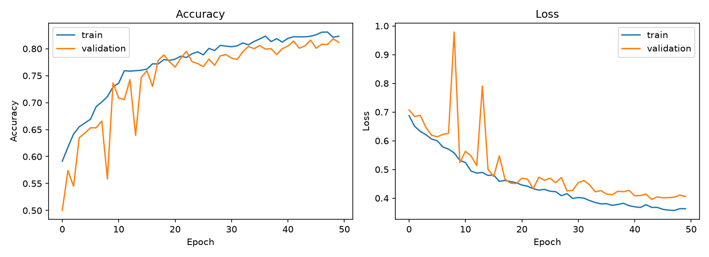
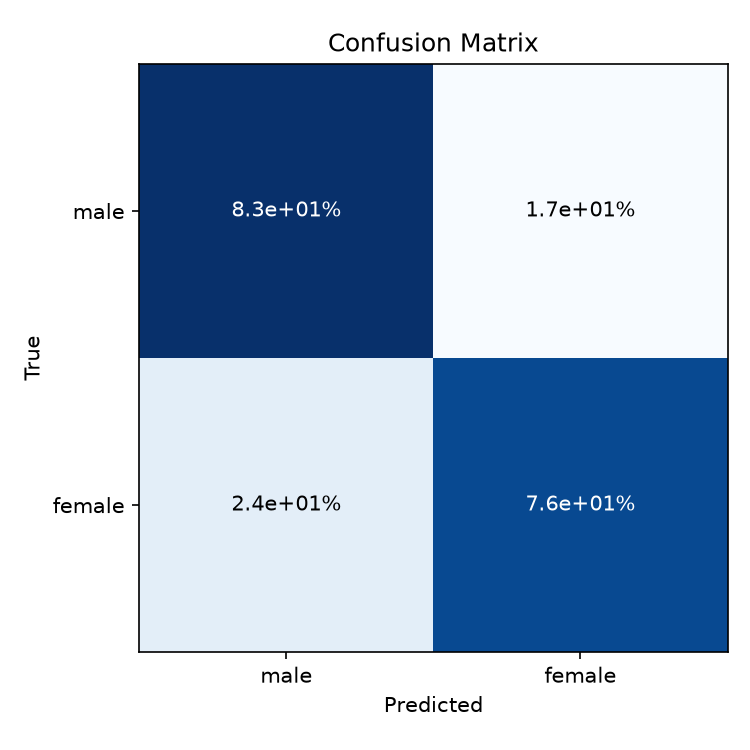

# ML-07-CNN

## CNN Gender Classification

This project uses a **Convolutional Neural Network (CNN)** to classify
face images into two classes:

-   Male
-   Female

The project uses the `age_gender.csv` dataset. The image pixel data is
processed and used to train a CNN model.

------------------------------------------------------------------------

## Project Structure

``` text
ML-07-CNN/
│
├── age_gender.csv
├── cnn_model.py
├── data_loader.py
├── evaluate.py
├── main.py
├── preprocessing.py
├── split_data.py
├── test_cnn.py
├── README.md
│
├── outputs/
└── venv/
```

------------------------------------------------------------------------

## File Description

### `age_gender.csv`

This is the **dataset** used in the project.

It contains information about face images, including:

-   Age
-   Gender
-   Image pixel values

The pixel values are used as input for the CNN model.

------------------------------------------------------------------------

### `preprocessing.py`

This file is responsible for **preparing the raw dataset** before
training.

It can handle tasks such as:

-   Reading the dataset
-   Converting pixel values into images
-   Resizing images
-   Converting images to grayscale
-   Normalizing pixel values
-   Preparing labels

The purpose is to make the raw data suitable for the CNN model.

------------------------------------------------------------------------

### `split_data.py`

This file is responsible for **splitting the dataset** into different
groups.

The data is separated into:

``` text
Training Data
Validation Data
Test Data
```

The training data is used to train the model. Validation data is used to
check the model during training, and test data is used for the final
evaluation.

------------------------------------------------------------------------

### `data_loader.py`

This file is responsible for **loading the prepared data** into the
program.

It loads the images and labels and prepares them for the CNN model.

It can handle:

-   Loading image data
-   Loading labels
-   Creating training data
-   Creating validation data
-   Creating test data

------------------------------------------------------------------------

### `cnn_model.py`

This is the main file for the **CNN model**.

It creates and trains the Convolutional Neural Network.

The model learns patterns from face images and uses these patterns to
classify:

``` text
Male
Female
```

This file can contain:

-   CNN architecture
-   Convolution layers
-   Pooling layers
-   Dense layers
-   Model compilation
-   Model training
-   Model prediction

------------------------------------------------------------------------

### `evaluate.py`

This file is responsible for **evaluating the trained model**.

It checks how well the CNN performs using test data.

It can generate:

-   Accuracy
-   Loss
-   Confusion Matrix
-   Accuracy and Loss graphs

The confusion matrix helps show how many images were correctly and
incorrectly classified.

------------------------------------------------------------------------

### `main.py`

This is the **main program** of the project.

It controls the overall workflow of the project.

The process is approximately:

``` text
Load Data
    ↓
Preprocess Data
    ↓
Split Data
    ↓
Create CNN
    ↓
Train Model
    ↓
Evaluate Model
    ↓
Save Results
```

Run the project with:

``` bash
python main.py
```

------------------------------------------------------------------------

### `test_cnn.py`

This file is used to **test the CNN model** separately.

It can be used to check whether the trained model can make predictions
on test or new images.

The basic process is:

``` text
Input Image
     ↓
CNN Model
     ↓
Prediction
     ↓
Male / Female
```

-----------------------------------------------------------------

### `outputs/`

This folder stores the **results generated by the project**.

Examples include:

``` text
outputs/
├── accuracy_loss.png
├── confusion_matrix.png
├── predictions.csv
└── model files
```

The exact files depend on the project code.

------------------------------------------------------------------------

## Dataset and Image Size

The project uses grayscale face images with a size of:

``` text
64 × 64 pixels
```

Each image contains:

``` text
64 × 64 = 4,096 pixels
```

The pixel values are used as input for the CNN model.

------------------------------------------------------------------------

## Model Settings

The main training settings are:

``` python
IMG_SIZE = 64
TEST_SIZE = 0.2
VAL_SIZE = 0.2
MAX_PER_CLASS = 3000
EPOCHS = 50
BATCH_SIZE = 32
LEARNING_RATE = 0.0001
```

### Parameter Description

  Parameter         Description
  ----------------- ----------------------------------------------
  `IMG_SIZE`        Image size used by the CNN
  `TEST_SIZE`       Percentage of data used for testing
  `VAL_SIZE`        Percentage of data used for validation
  `MAX_PER_CLASS`   Maximum number of images used for each class
  `EPOCHS`          Number of training rounds
  `BATCH_SIZE`      Number of images processed at one time
  `LEARNING_RATE`   Controls how fast the model learns

------------------------------------------------------------------------

## Requirements

The project uses:

-   Python
-   TensorFlow
-   Keras
-   NumPy
-   Pandas
-   Scikit-learn
-   Matplotlib
-   OpenCV

Install the required libraries with:

``` bash
pip install tensorflow numpy pandas scikit-learn matplotlib opencv-python
```


------------------------------------------------------------------------

## Results

### Training History

The following graph shows the training and validation accuracy and loss during model training.



### Confusion Matrix

The confusion matrix shows the prediction results of the CNN model for the Male and Female classes.


