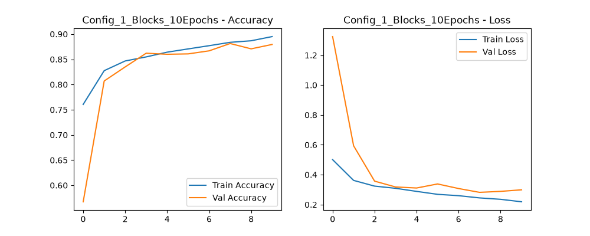
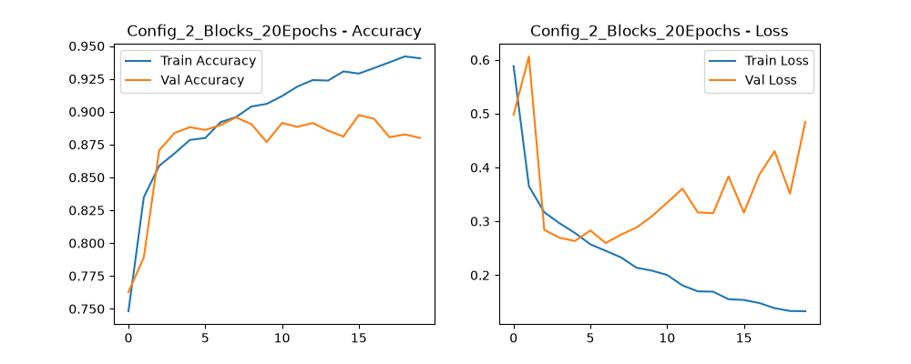
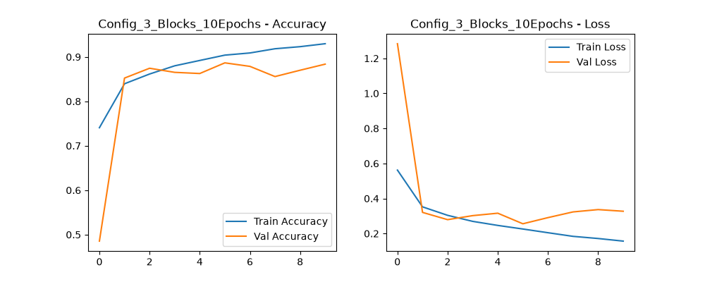

<!-- python -m venv .venv -->
<!-- .\.venv\Scripts\activate -->
# Age and Gender Classification using DCNN

This project uses a Deep Convolutional Neural Network (DCNN) to classify age and gender from face images.

## Project Structure

Here is a simple explanation of each file in this project:

- **`data_loader.py`**:
  - Loads the dataset (`age_gender.csv`).
  - Converts pixel numbers into image arrays for training.

- **`preprocessing.py`**:
  - Scales pixel values (from 0–255 to 0–1) to help the model learn better.

- **`split_data.py`**:
  - Splits the dataset into training set and testing set.

- **`vgg_model.py`**:
  - Contains the DCNN model architecture (layers, convolution, pooling, and dropout).

- **`evaluate.py`**:
  - Evaluates the model accuracy and loss.
  - Saves performance graphs into the `outputs/` folder.

- **`main.py`**:
  - The main script to run the whole project.
  - Runs experiments with different numbers of epochs and model configurations.

## Model Performance & Results

Below are the performance graphs and evaluation results for different model configurations saved in the `outputs/` folder[cite: 1]:

### 1. Config 1 (1 Blocks, 10 Epochs)

### 2. Config 2 (2 Blocks, 20 Epochs)

### 3. Config 3 (3 Blocks, 10 Epochs)

