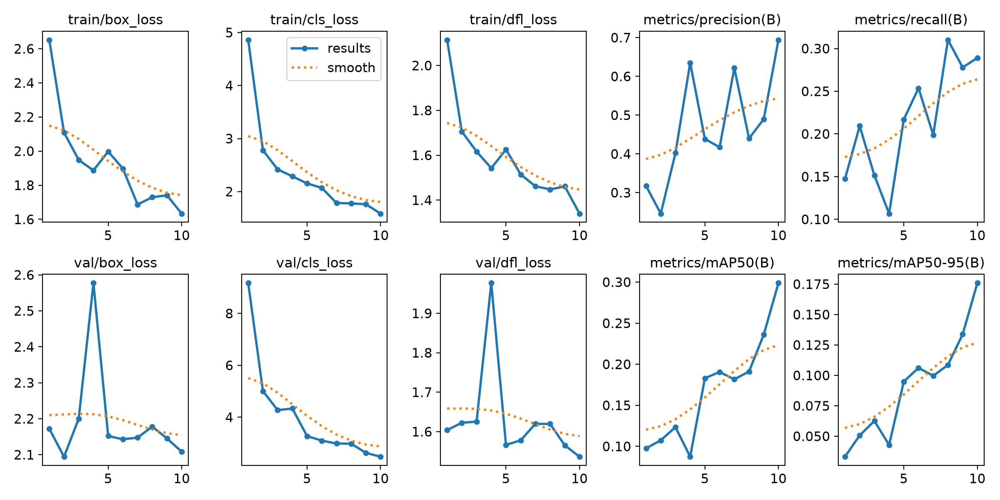
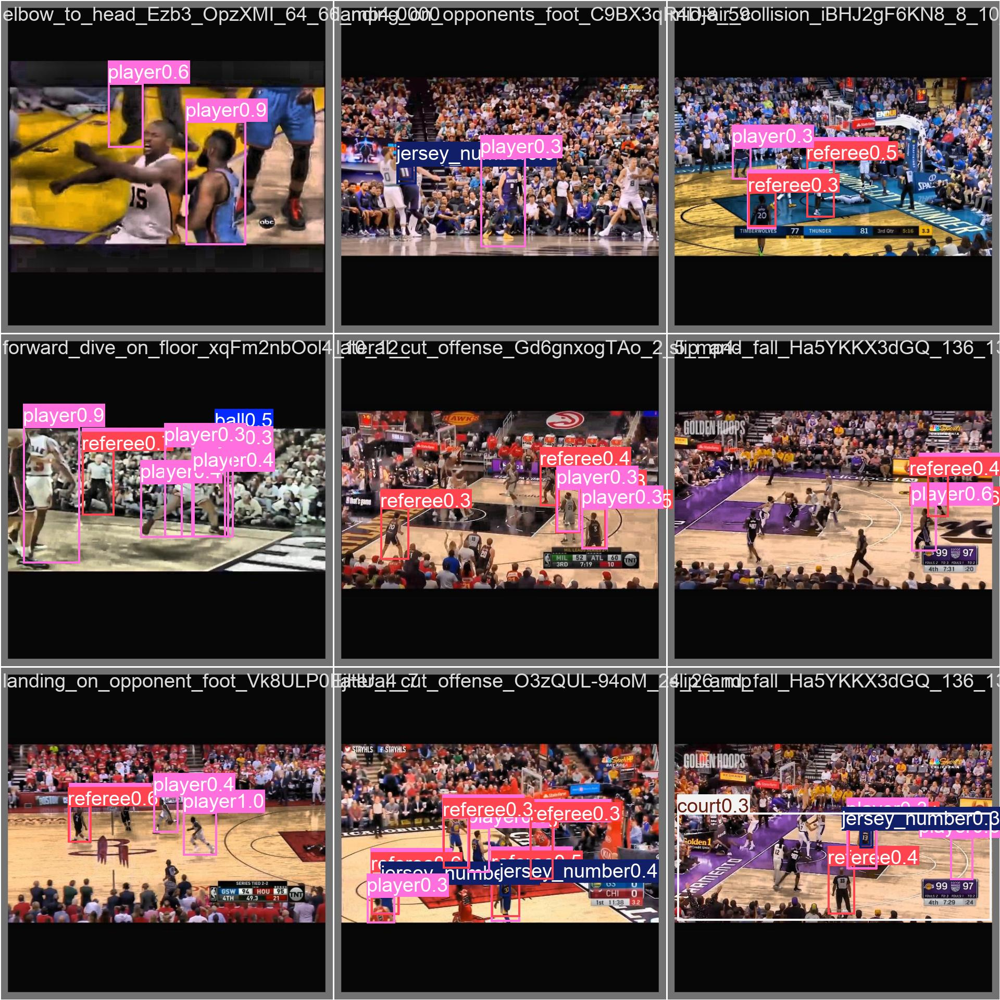
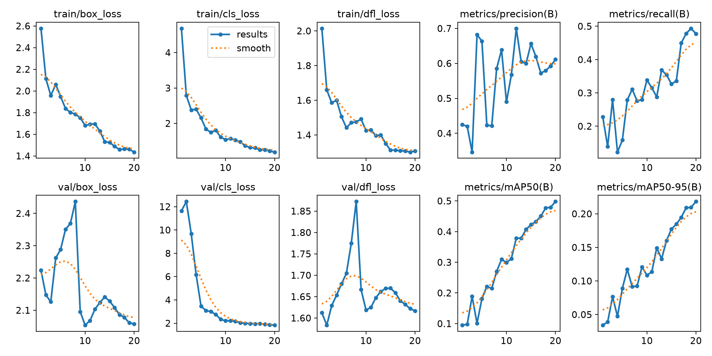
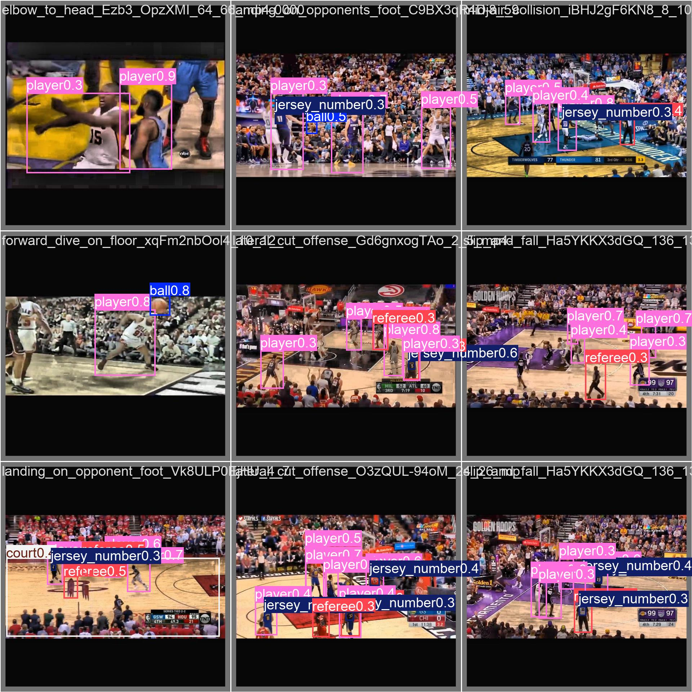

# Object Detection II Project

This project is for training and testing an Object Detection model using YOLO.

## 📁 Project Structure

```
ML-10-Object Detection II/
├── dataset/                    # Folder for training and testing dataset
├── runs/                       # Training results folder
│   └── detect/
│       └── runs/
│           └── detect/
│               ├── exp_10_epochs/   # Results from training 10 epochs
│               │   ├── weights/     # Best and last trained weights (.pt)
│               │   ├── results.png  # Training graphs
│               │   ├── results.csv  # Detailed metric logs
│               │   ├── confusion_matrix.png
│               │   └── val_batch0_pred.jpg
│               └── exp_20_epochs/   # Results from training 20 epochs
│                   ├── weights/     # Best and last trained weights (.pt)
│                   ├── results.png  # Training graphs
│                   ├── results.csv  # Detailed metric logs
│                   ├── confusion_matrix.png
│                   └── val_batch0_pred.jpg
├── README.md                   # Project documentation
├── requirements.txt             # Required Python libraries
├── train.py                     # Script to train the model
├── evaluate.py                  # Script to evaluate model performance
├── image_test.py                # Script to test single image
└── realtime_test.py             # Script to test real-time webcam
```

## 🚀 How to Install and Run

### 1. Install Libraries
Open your terminal and run:
```bash
pip install -r requirements.txt
```

### 2. Train the Model
To start training the model:
```bash
python train.py
```

### 3. Test on Images
To test prediction on an image:
```bash
python image_test.py
```

### 4. Test Real-time Video
To test with your webcam:
```bash
python realtime_test.py
```

## 📊 Training Results & Evaluation

We trained the model in two experiments: **10 Epochs** and **20 Epochs**.

---

### 1. Experiment: 10 Epochs (`exp_10_epochs`)

This experiment trained the model for 10 rounds.

#### Training Graph


#### Prediction Output


#### Summary:
* The model learned basic patterns quickly in 10 epochs.
* Fast training time, but accuracy can still be improved.

---

### 2. Experiment: 20 Epochs (`exp_20_epochs`)

This experiment trained the model for 20 rounds to get better accuracy.

#### Training Graph


#### Prediction Output


#### Summary:
* **Higher Accuracy:** Training loss decreased further compared to 10 epochs.
* **Better Detection:** The model detects objects with higher confidence and fewer errors.
* **Conclusion:** Training for 20 epochs gives better overall performance than 10 epochs.
# dataset : https://universe.roboflow.com/biomechanics-bcefh/basketball-1yw4a/dataset/37
